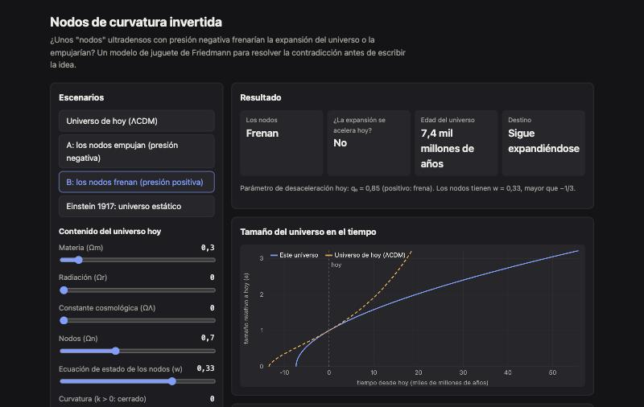

<div align="center">

# Toy Universe

**Nodos de curvatura invertida.** Un modelo de juguete de Friedmann para responder una pregunta concreta: ¿la presión negativa frena la expansión del universo o la acelera?

[**▶ Probala en vivo**](https://loiaconobruno.github.io/toy-universe/) · [**📄 Paper y guía**](https://loiaconobruno.github.io/toy-universe/guia.html) · [Cómo funciona](#cómo-funciona) · [Limitaciones](#limitaciones)

[](https://github.com/LoiaconoBruno/toy-universe/actions/workflows/tests.yml)


[](LICENSE)



</div>

Modelo de juguete de Friedmann, interactivo, para resolver la contradicción central de la idea: zonas ultradensas con **presión negativa** ("nodos"), **¿frenan la expansión del universo o la empujan?**

## Por qué

La idea original quiere que los nodos contrarresten la expansión con presión negativa. Pero en relatividad general la presión también "pesa": la segunda ecuación de Friedmann es

```
ä/a = −(4πG/3) · Σ (ρ + 3p/c²)
```

y una presión lo bastante negativa (menos de −1/3 de la densidad de energía) cambia el signo de su aporte: **empuja**. Antes de escribir la idea, como ciencia ficción dura o como esbozo teórico, conviene elegir entre dos versiones:

- **A, los nodos empujan:** son la fuente de la expansión acelerada, como en la propuesta de Farrah y otros (2023) sobre agujeros negros acoplados a la expansión.
- **B, los nodos frenan:** suman atracción. El antecedente es el universo estático de Einstein (1917), que Eddington mostró inestable en 1930.

La página deja jugar con las dos y con el equilibrio de Einstein.

## Instalación

No hace falta instalar nada: **[abrila en el navegador](https://loiaconobruno.github.io/toy-universe/)**.

Para usarla sin conexión o modificarla:

```bash
git clone https://github.com/LoiaconoBruno/toy-universe.git
```

Después abrí `index.html` con doble clic. No hay dependencias ni paso de build. Para correr los tests hace falta Node 18 o más nuevo:

```bash
npm test
```

## Uso

Abrí la [demo en vivo](https://loiaconobruno.github.io/toy-universe/) o `index.html` con doble clic.

Ejemplo:

1. Al abrir está el **Universo de hoy (ΛCDM)**: 30 % materia y 70 % constante cosmológica. La expansión **se acelera** (q₀ = −0,55) y la edad da **13,5 mil millones de años**.
2. Apretá **A: los nodos empujan (presión negativa)**: los nodos (w = −1) reemplazan a la constante cosmológica y el resultado es idéntico. Los nodos **empujan**.
3. Mové la **ecuación de estado de los nodos (w)** a −0,2: ahora **frenan**, la expansión ya no se acelera (q₀ = 0,29) y la curva se separa de la de ΛCDM.
4. Apretá **B: los nodos frenan (presión positiva)**: con w = 1/3, q₀ = 0,85 y la edad baja a 7,4 mil millones de años, menos que las estrellas más viejas que se conocen.
5. Apretá **Einstein 1917: universo estático**. Viene con un empujón mínimo (0,001) y el destino es **Sigue expandiéndose**: en la curva, el tamaño se queda quieto un buen rato y después se escapa. Mové el empujón a 0: **Se queda quieto**. Movelo a −0,001: **Recolapsa**. El equilibrio existe, pero cualquier perturbación lo rompe.

## Cómo funciona

- Unidades: tiempo en 1/H₀ y densidades en unidades donde 8πG/3 = 1, así que en un universo que hoy se expande a ritmo H₀ las densidades son los Ω de siempre. Para pasar a años se usa H₀ = 70 km/s/Mpc (1/H₀ ≈ 13,97 mil millones de años).
- Cada componente escala como `ρ·a^(−3(1+w))`: materia w = 0, radiación w = 1/3, constante cosmológica w = −1 y nodos con w elegible.
- Se integra `ä = −(a/2)·Σ ρᵢ(1 + 3wᵢ)·a^(−3(1+wᵢ))` con Runge-Kutta de orden 4 y paso adaptativo, hacia atrás hasta el big bang (a → 0) y hacia adelante hasta 4/H₀ o un recolapso.
- El ritmo inicial sale de la primera ecuación de Friedmann, `ȧ₀² = Σρᵢ − k`. Si da negativo, ese universo no puede existir y la página lo avisa.
- Equivalencia con Farrah y otros: si la masa de los nodos crece como `a^k`, su densidad va como `a^(k−3)`, que es lo mismo que `w = −k/3`.

La lógica está en `src/cosmos.js`, sin DOM, y se testea con:

```bash
npm test
```

## Limitaciones

- Universo homogéneo: los nodos se tratan como un fluido más, no como objetos localizados.
- No ajusta datos reales (supernovas, fondo cósmico, DESI). Los escenarios son ilustrativos.
- La "retroalimentación" que haría estable el equilibrio está modelada solo a través de w; un mecanismo dinámico de verdad queda pendiente.

## Próximos pasos

- Agregar una w que cambie con el tiempo (como sugieren los resultados de DESI) y una retroalimentación explícita.
- Elegir la versión A o B y escribir el esbozo en una página.
- Leer sobre las gravastars (Mazur y Mottola, 2001) y la propuesta de Farrah y otros (2023).

## Paper de uso y guía

[`guia.html`](https://loiaconobruno.github.io/toy-universe/guia.html) (fuente en [`docs/guia.md`](docs/guia.md)) tiene un paper de uso paso a paso y una guía de unas 20 páginas sobre la idea de fondo, con citas a los especialistas del tema.

## Licencia

MIT
